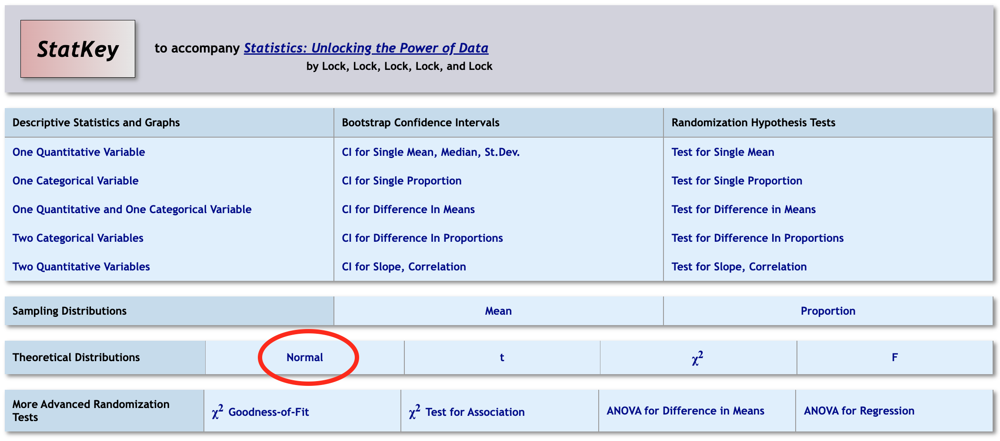
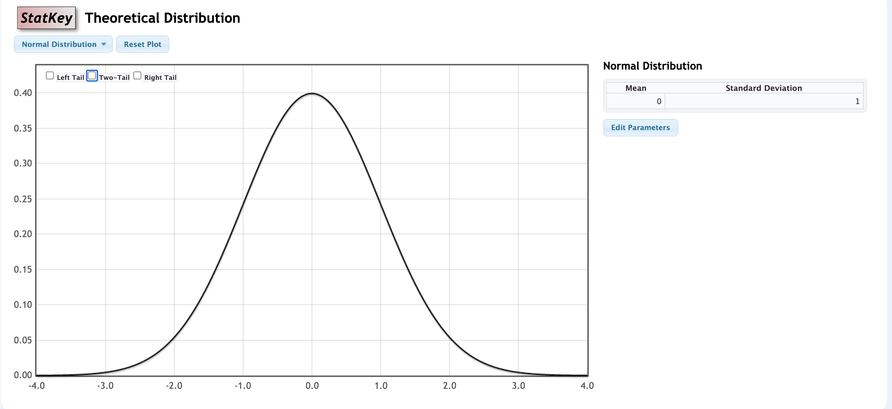

```{r, echo=F,message=FALSE}
library(mosaic)
library(Lock5Data)
```

## Warm-Up: Turn and Talk (60 sec)

In Chapters 3 and 4 you used StatKey to build randomization distributions for a proportion.

1.  Where is a randomization distribution centered?
2.  What shape does it usually have?

::: notes
Intent: students recall that randomization distributions are centered at the null value and are bell-shaped, so a normal curve could stand in for the simulation. Take 2-3 answers, then move on. Do not define anything yet.
:::

## Outline

-   The method in two steps
-   Try it: a real example
-   Why it works: normal distributions and the Central Limit Theorem
-   Three ways to find the same $p$-value
-   More practice

## The Method in Two Steps {.smaller}

If the randomization distribution is bell-shaped, we can skip the simulation.

**Step 1.** Standardize: how many standard errors is the sample statistic from the null value?

$$
z=\frac{\text{Sample statistic}-\text{Null parameter}}{\text{SE}}
$$

**Step 2.** Find the $p$-value: the area beyond $z$ under the **standard normal** curve (mean 0, standard deviation 1).

-   **One-tailed** $p$-values
    -   $p=P(Z\ge z)$ if $H_a$ is "$>$", or $p=P(Z\le z)$ if $H_a$ is "$<$"

-   **Two-tailed** $p$-values ($H_a$ is "$\neq$")
    -   Double the one-tailed value

::: notes
Keep this fast; students should see that there are only two steps. P(Z >= z) means the probability to the right of z under the standard normal density Z. z lets us judge extremity on a common scale. No need to explain why it works yet; that comes after the first example.
:::

## Finding Areas under the Normal Curve

Use StatKey to find areas and endpoints of intervals:



## Finding Areas under the Normal Curve (cont'd)

Use StatKey to find areas and endpoints of intervals:



## Example 1: Is a College Degree Still Seen as Essential? {.smaller}

A 2023 Pew Research Center probability-based survey of 1,627 U.S. adults found that only 25% said it is extremely or very important to have a four-year college degree to get a well-paying job. Does this provide evidence that fewer than 30% of all U.S. adults hold this view? The standard error assuming $H_0$ is true is SE = 0.011.

**(a)** What are the null and alternative hypotheses?

::: {.ws}
:::

**(b)** What is the standardized test statistic?

::: {.ws}
:::

::: aside
Source: Pew Research Center, "Is College Worth It?" (May 2024), American Trends Panel Wave 139.
:::

::: notes
(a) H0: p = 0.30, Ha: p < 0.30, where p is the proportion of all U.S. adults who say a degree is extremely or very important. (b) z = (0.25 - 0.30)/0.011 = -4.5. Check on SE: sqrt(0.30*0.70/1627) = 0.0114, consistent with 0.011. (The 1,627 is presumably the subset of the 5,203 Wave 139 respondents asked this question.)
:::

## Example 1 (cont'd) {.smaller}

Recall: $H_0: p=0.30$, $H_a: p<0.30$, $\hat{p}=0.25$, SE = 0.011.

**(c)** Use the standard normal distribution to find the $p$-value. Sketch it.

::: {.ws-l}
:::

**(d)** What is the conclusion of the test, in context?

::: {.ws-l .ed contenteditable="true"}
:::

::: notes
(c) In StatKey's Normal tool use mean 0, SD 1, left tail, endpoint -4.5. p is about 0.000003 (StatKey will show a tiny number or 0). Left-tailed because Ha is "fewer than". (d) Very strong evidence that fewer than 30% of U.S. adults think a four-year degree is extremely or very important for a well-paying job. Reject H0. Possible discussion: statistically significant is not the same as practically large; here the drop is 5 points. Point out how short this was: two steps, one StatKey lookup.
:::

## Why It Works: The Normal Distribution

-   A **normal distribution** has a *symmetric, single-peaked, and bell-shaped* density curve.

-   Completely characterized by its mean $\mu$ and standard deviation $\sigma$

    -   Centered at mean $\mu$

    -   Inflection points at $\mu-\sigma$ and $\mu+\sigma$

-   Notation: $X$ has a Normal distribution with mean $\mu$ and standard deviation $\sigma$

$$
X\sim N(\mu,\sigma)
$$

## Standard Normal Distribution

The standard normal $(Z)$ distribution has

-   Mean $\mu=0$

-   Standard deviation $\sigma=1$

-   Every normal distribution can be *standardized* to follow a *standard normal distribution*.

$$
Z=\frac{X-\mu}{\sigma}
$$

## Central Limit Theorem {.smaller}

> For random samples with a *sufficiently large* sample size, the distribution of sample statistics for a mean or a proportion is approximately normal.

-   Holds for **any** original distribution, although "sufficiently large" varies: the more skewed the original distribution, the larger $n$ must be.

-   Quantitative variables that are not very skewed: $n\ge 30$ is usually sufficient.

-   Categorical variables: counts of at least 10 in each category are usually sufficient.

::: {.fragment}
**Turn and talk (30 sec):** A sample proportion is $\hat{p}=0.52$ from $n=1000$ when $p=0.5$. Do the CLT conditions hold? How do you know?
:::

::: notes
Counts are 520 and 480, both far above 10. Quick check, no writing.
:::

## Normal Distributions and Randomization Distributions {.smaller}

If the randomization distribution is normal, it is centered at the null value with spread equal to the SE:

$$
N(\text{null value}, \text{SE})
$$

So a $p$-value is the area in the appropriate tail(s) beyond the observed statistic.

Standardizing ($z$) turns this into the same question for *every* test: the area beyond $z$ under the standard normal curve.

::: notes
This is the "why" behind the two steps from earlier. Example 2 shows it numerically.
:::

## Example 2: Three Ways to Find a P-value (1 of 2) {.smaller}

Test $H_0: p=0.5$ vs $H_a: p>0.5$ using a sample proportion of 520 out of 1000, or $\hat{p}=0.52$.

**Randomization distribution (StatKey):** *Test for a Single Proportion* → **Edit Data** → sample size 1000, count 520, null proportion 0.5 → generate at least 5000 samples → right tail.

**(a)** Standard error from the randomization distribution: \_\_\_\_\_\_\_\_\_\_

**(b)** Randomization $p$-value: \_\_\_\_\_\_\_\_\_\_

**(c)** Model the randomization distribution with a normal distribution with mean 0.5 and standard deviation equal to this SE. Find the area to the right of 0.52. Sketch it.

::: {.ws-l}
:::

::: notes
(a) SE is about 0.016 (theory: sqrt(0.5*0.5/1000) = 0.0158). (b) About 0.10 (varies run to run; 0.09 to 0.12 is typical). (c) Normal(0.5, 0.016) area right of 0.52 is about 0.106 (0.1056 with SE = 0.0158). Students should type the mean and SD into StatKey's Normal tool.
:::

## Example 2: Three Ways to Find a P-value (2 of 2) {style="font-size: 0.75em;"}

Recall: $H_0: p=0.5$, $H_a: p>0.5$, $\hat{p}=0.52$, $n=1000$.

**(d)** Find the standardized test statistic $z$. Then find the $p$-value from the *standard* normal distribution.

::: {style="height: 3em;"}
:::

**(e)** Compare the three $p$-values.

<table class="fillin" style="font-size: 0.9em;">
<tr><th style="width:1.5em;height:1.6em;"></th><th style="width:16em;height:1.6em;">Method</th><th style="width:6em;height:1.6em;">$p$-value</th></tr>
<tr><td class="lab" style="height:1.6em;">1</td><td style="height:1.6em;">Randomization distribution</td><td style="height:1.6em;"></td></tr>
<tr><td class="lab" style="height:1.6em;">2</td><td style="height:1.6em;">$N(0.5,\text{SE})$ area</td><td style="height:1.6em;"></td></tr>
<tr><td class="lab" style="height:1.6em;">3</td><td style="height:1.6em;">Standard normal $Z$ area</td><td style="height:1.6em;"></td></tr>
</table>

What do you notice, and why?

::: {.ws .ed contenteditable="true"}
:::

::: notes
(d) z = (0.52 - 0.5)/0.0158 = 1.26; p = P(Z >= 1.26) = 0.103. Using SE = 0.016 gives z = 1.25 and p = 0.106. (e) Table: about 0.10, 0.106, 0.103. All nearly equal: the randomization distribution is approximately normal, and standardizing just rescales the same curve. Differences are simulation noise. This is the key idea of the section; connect it back to Example 1, where we skipped the simulation.
:::
## Example 3: A Gap in College Completion? {.smaller}

According to the U.S. Census Bureau's Current Population Survey (2024), 47% of U.S. women ages 25 to 34 have a bachelor's degree, compared with 37% of men in the same age group. Is this gap statistically significant? Assume the standard error for the difference in proportions under $H_0$ is SE = 0.03.

**(a)** What are the null and alternative hypotheses? (Let $p_W$ and $p_M$ be the population proportions with a bachelor's degree.)

::: {.ws}
:::

**(b)** What is the standardized test statistic?

::: {.ws}
:::

::: aside
Source: Pew Research Center analysis of Census Bureau CPS ASEC data (Nov 2024).
:::

::: notes
(a) H0: p_W - p_M = 0 (or p_W = p_M), Ha: p_W - p_M != 0. The question asks whether there is a gap in either direction, so two-sided. (b) z = (0.47 - 0.37 - 0)/0.03 = 3.33.

SE = 0.03 is given for the exercise. The real CPS samples are large, so the true SE would be considerably smaller; say so if a student asks.
:::

## Example 3 (cont'd) {.smaller}

Recall: $H_0: p_W-p_M=0$, $H_a: p_W-p_M\neq 0$, difference = 0.10, SE = 0.03.

**(c)** Use the standard normal distribution to find the $p$-value. Sketch it.

::: {.ws-l}
:::

**(d)** What is the conclusion of the test, in context?

::: {.ws-l .ed contenteditable="true"}
:::

::: notes
(c) One tail P(Z >= 3.33) = 0.00043; doubled for a two-sided alternative, p = 0.0009. (d) Strong evidence that the proportion of women ages 25 to 34 with a bachelor's degree differs from that of men (higher for women). Reject H0. Tie back to the "double the one-tailed value" rule.
:::

## Summary

-   If the distribution of a statistic is normal, the standardized test statistic is:

$$
z=\frac{\text{Sample statistic}-\text{Null parameter}}{\text{SE}}
$$

-   Obtain the $p$-value by comparing $z$ to the **standard normal** $N(0,1)$ distribution.

## Wrapping Up

::: {.incremental}
-   Randomization distributions that are bell-shaped can be modeled with a normal curve.
-   $z$ counts how many standard errors the sample statistic is from the null value.
-   One-tailed $p$-value: area in one tail of $Z$; two-tailed: double it.
-   Direction of $H_a$ ($<$, $>$, $\neq$) tells you which tail(s) to use.
:::
