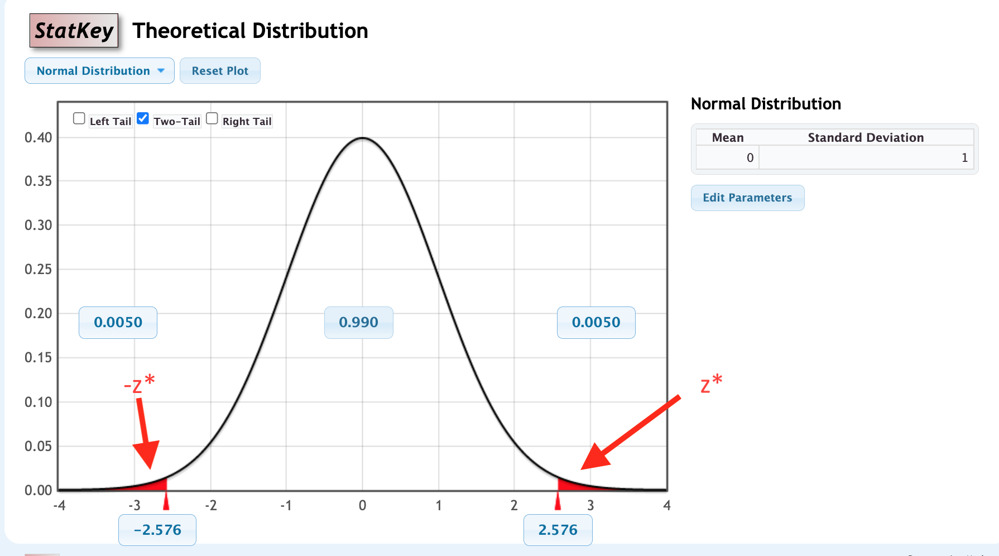

```{r, echo=F,message=FALSE}
library(mosaic)
library(Lock5Data)
```

## Warm-Up: Turn and Talk (60 sec)

In Chapter 3 you found a 95% confidence interval with the rule

$$
\text{statistic} \pm 2\times \text{SE}
$$

1.  Where does the "2" come from?
2.  What if you want a 90% or a 99% interval? Would the same "2" still work?

::: notes
Intent: students recall that 2 is roughly the number of SEs that captures the middle 95% of a bell-shaped distribution (rule of thumb: 95% within 2 SDs), and see that other confidence levels need a different multiplier. That need is today's topic: the critical value z*. Take 2-3 answers, then move on.
:::

## Outline

-   The method: $\text{statistic} \pm z^* \times \text{SE}$
-   Finding $z^*$ with StatKey
-   Try it: real examples
-   Why it works: the normal model
-   Putting 5.1 and 5.2 together in StatKey

## The Method {.smaller}

If a statistic is normally distributed, a P% confidence interval for the parameter is

$$\text{statistic} \pm z^* \times \text{SE} $$

where $z^*$ is the **critical value**: the value with area P% between $-z^*$ and $z^*$ under the standard normal curve (mean 0, standard deviation 1).

-   For 95% confidence, $z^*\approx 1.96$, which is where the "2" came from.
-   This extends the SE method to confidence levels beyond 95%.

::: notes
Keep this fast; the point is that the only new ingredient is z*. The standard normal was introduced in 5.1 (mean 0, SD 1; z counts SEs from the center).
:::

## Use StatKey to Find the Critical Value $z^*$



## Example 1: Finding $z^*$ {.smaller}

Use StatKey's normal distribution to find the endpoints $\pm z^*$ with the given area in the middle. Sketch the area.

**(a)** The area between $\pm z^*$ is 0.95

::: {.ws-l}
:::

**(b)** The area between $\pm z^*$ is 0.80

::: {.ws-l}
:::

**(c)** The area between $\pm z^*$ is 0.90

::: {.ws-l}
:::

::: notes
(a) 1.96. (b) 1.28. (c) 1.645 (StatKey shows 1.645 or 1.64). Mean 0, SD 1 in StatKey's Normal tool; choose Two-Tail and set the middle area; StatKey reports both endpoints. Point out that higher confidence gives a larger z* (wider interval). Part (c) is the old self-quiz item.
:::

## Example 2: Teens and TikTok {.smaller}

A Pew Research Center survey of 1,458 U.S. teens ages 13 to 17 (fall 2025) found that 21% say they use TikTok "almost constantly." Find a 95% confidence interval for the percentage of all U.S. teens who use TikTok almost constantly. Assume SE = 1.7 percentage points.

**(a)** What is $z^*$ for a 95% confidence interval?

::: {.ws}
:::

**(b)** Use $\text{statistic} \pm z^* \times \text{SE}$ to find the interval.

::: {.ws}
:::

**(c)** Interpret the interval in context.

::: {.ws-l .ed contenteditable="true"}
:::

::: aside
Source: Pew Research Center, "Teens, Social Media and AI Chatbots 2025" (Sept. 25 to Oct. 9, 2025).
:::

::: notes
(a) 1.96 (or about 2). (b) 21 +/- 1.96(1.7) = 21 +/- 3.3, so about (17.7%, 24.3%). (c) We are 95% confident that between about 18% and 24% of all U.S. teens ages 13 to 17 use TikTok almost constantly. Quick discussion: social media use is something students know well; sampling variability only, not bias.

Source details (checked on Pew's pages): 21% of teens use TikTok almost constantly; 1,458 teens ages 13 to 17, surveyed Sept. 25 to Oct. 9, 2025 via Ipsos KnowledgePanel; Pew's stated margin of sampling error is plus or minus 3.3 points for the full sample. The SE of 1.7 is that margin divided by 1.96 (a simple-random-sample SE would be about 1.1, since Pew's weighting adds variability); if a student asks, the interval here matches Pew's own reported margin.
:::

## Why It Works: The Normal Model

> If a bootstrap distribution is bell-shaped, a P% confidence interval can be found as the interval containing the middle P% of the normal distribution with mean equal to the observed sample statistic and standard deviation equal to the standard error of the statistic:

$$
N(\text{sample statistic}, \text{SE})
$$

Standardizing turns "the middle P% of $N(\text{statistic}, \text{SE})$" into "the middle P% of the standard normal," which is why $\text{statistic} \pm z^* \times \text{SE}$ works.

::: notes
Contrast with the 5.1 test: there the randomization distribution is centered at the NULL value; here the bootstrap distribution is centered at the SAMPLE statistic. Example 3 shows the three approaches agree.
:::

## Example 3: Confidence Intervals Three Ways (1 of 2) {.smaller}

In a July 2026 Gallup poll of 1,200 U.S. adults, 54% said they drink alcohol (about 648 of the 1,200). We want a 95% confidence interval for the proportion of all U.S. adults who drink alcohol.

**(a)** Sample statistic: \_\_\_\_\_\_\_\_\_\_

**Bootstrap (StatKey):** *CI for a Single Proportion* → **Edit Data** → sample size 1200, count 648 → generate at least 5000 samples → **Two-Tail** → middle 95%.

**(b)** Bootstrap standard error: \_\_\_\_\_\_\_\_\_\_ 95% percentile interval: \_\_\_\_\_\_\_\_\_\_

**(c)** Model the bootstrap distribution with a normal distribution with mean \_\_\_\_\_\_\_\_ and standard deviation \_\_\_\_\_\_\_\_. Use the Two-Tail option on this normal distribution to find the middle 95%.

::: {.ws}
:::

::: aside
Source: Gallup, "Americans' Drinking Remains at Record Low" (2026 Consumption Habits survey, July 1-19, 2026).
:::

::: notes
(a) 0.54 (648/1200). (b) SE is about 0.014 (theory: sqrt(.54*.46/1200) = 0.0144). Percentile interval about (0.512, 0.568); it varies slightly run to run. (c) Normal with mean 0.54 and SD 0.014; middle 95% is about (0.512, 0.568).

Source details (checked on Gallup's page): 54% of U.S. adults say they drink alcohol, a record-low 54% for the second year in a row; 1,200 adults aged 18+ in all 50 states and DC, surveyed July 1-19, 2026; Gallup's stated margin of error is plus or minus 4 points at 95% confidence. The count of 648 is just 0.54 x 1,200 for StatKey (Gallup's 54% is weighted). Gallup's plus or minus 4 is a bit wider than the simple-random-sample margin here (plus or minus 2.8) because Gallup's weighting adds variability; if a student asks, say our SE assumes a simple random sample.
:::

## Example 3: Three Ways (2 of 2) {style="font-size: 0.7em;"}

Recall: 54% of 1,200 adults, $\hat{p}=0.54$, bootstrap SE about 0.014.

**(d)** What is $z^*$ for a 95% interval? \_\_\_\_\_\_\_\_ Use $\text{statistic} \pm z^* \times \text{SE}$ to find the interval.

::: {style="height: 2em;"}
:::

**(e)** Compare the three 95% intervals.

<table class="fillin" style="font-size: 0.85em;">
<tr><th style="width:1.5em;height:1.5em;"></th><th style="width:16em;height:1.5em;">Method</th><th style="width:8em;height:1.5em;">95% interval</th></tr>
<tr><td class="lab" style="height:1.5em;">1</td><td style="height:1.5em;">Bootstrap percentiles</td><td style="height:1.5em;"></td></tr>
<tr><td class="lab" style="height:1.5em;">2</td><td style="height:1.5em;">$N(\text{statistic},\text{SE})$ middle 95%</td><td style="height:1.5em;"></td></tr>
<tr><td class="lab" style="height:1.5em;">3</td><td style="height:1.5em;">$\text{statistic} \pm z^* \times \text{SE}$</td><td style="height:1.5em;"></td></tr>
</table>

What do you notice, and why?

::: {.ws .ed contenteditable="true"}
:::

::: notes
(d) z* = 1.96; 0.54 +/- 1.96(0.0144) = 0.54 +/- 0.028, about (0.512, 0.568). (e) All three agree to about two decimal places: the bootstrap distribution is approximately normal, and the formula is just the normal model written out. Differences come from simulation noise. Tie back to 5.1: the p-values agreed three ways for the same reason.
:::

## Example 4: The City that Never Sleeps {.smaller}

New York is known as "the city that never sleeps." A random sample of 25 New Yorkers were asked how much sleep they get per night, and the average was 7.73 hours. We are told the standard error for this estimate is 0.15 hours. Use the normal distribution to find a 99% confidence interval for the average sleep of New Yorkers.

**(a)** What is $z^*$?

::: {.ws}
:::

**(b)** Find the 99% confidence interval.

::: {.ws}
:::

**(c)** Interpret the interval in context.

::: {.ws-l .ed contenteditable="true"}
:::

::: notes
(a) z* = 2.576 (StatKey about 2.58). (b) 7.73 +/- 2.576(0.15) = 7.73 +/- 0.39, about (7.34, 8.12) hours. (c) We are 99% confident that the mean nightly sleep of all New Yorkers is between about 7.34 and 8.12 hours. Optional: a 99% interval is wider than a 95% one; a small sample (n = 25) is why we are told the SE rather than trusting the CLT blindly. The next sections replace this with t-based methods.
:::

## Putting 5.1 and 5.2 Together: StatKey Activity (1 of 4) {.smaller}

**Proportion of NFL overtimes won by the coin flip winner.**

*StatKey:* **Test for a Single Proportion** → choose the dataset *NFL Wins in Overtime Games* → generate a randomization distribution (several thousand samples) under $H_0: p=0.5$. The original sample proportion is 0.561. Use $H_a: p>0.5$ and the **Right-Tail** option.

**(a)** Randomization $p$-value: \_\_\_\_\_\_\_\_\_\_

**(b)** Standard error of the randomization distribution: \_\_\_\_\_\_\_\_\_\_

::: notes
Data: coin flip winner won 240 of 428 overtime games, so p-hat = 0.561. (a) About 0.006 (varies run to run; 0.004 to 0.009 typical). (b) SE about 0.024 (theory: sqrt(.5*.5/428) = 0.0242).
:::

## StatKey Activity: NFL Overtimes (2 of 4) {.smaller}

Recall: $H_0: p=0.5$, $H_a: p>0.5$, $\hat{p}=0.561$, randomization SE about 0.024.

**(c)** Compute the standardized test statistic

$$
z=\frac{\text{Sample statistic}-\text{Null parameter}}{\text{SE}}
$$

::: {.ws}
:::

**(d)** In StatKey, switch to the normal distribution (mean 0, SD 1), choose **Right-Tail**, and find the area to the right of your $z$: \_\_\_\_\_\_\_\_\_\_

**(e)** Compare the two $p$-values.

::: {.ws-l .ed contenteditable="true"}
:::

::: notes
(c) z = (0.561 - 0.5)/0.024 = 2.5 (2.52 with the unrounded SE 0.0242). (d) About 0.006 (z = 2.52 gives 0.0059; z = 2.5 gives 0.0062). (e) The two p-values agree (both about 0.006): strong evidence the coin flip winner wins more than half of overtime games (240 of 428). Link to 5.1.
:::

## StatKey Activity: Atlanta Commute Times (3 of 4) {.smaller}

**Bootstrap confidence interval for mean Atlanta commute time.**

*StatKey:* **Confidence Interval for a Mean** → choose the dataset *Atlanta Commute Time*. The sample mean commute time is 29.11 minutes. Generate a bootstrap distribution (several thousand samples).

**(a)** 90% interval using **Two-Tail**: \_\_\_\_\_\_\_\_\_\_ to \_\_\_\_\_\_\_\_\_\_

**(b)** Standard error of the bootstrap distribution: \_\_\_\_\_\_\_\_\_\_

::: notes
Expected (check in StatKey; I could not open the dataset here): the Atlanta sample has n = 500 and SD about 20.7 minutes, so (b) SE is about 0.93 minutes. (a) The percentile interval is about (27.6, 30.7) minutes; the bootstrap distribution is slightly right-skewed because commute times are.
:::

## StatKey Activity: Atlanta Commute Times (4 of 4) {.smaller}

Recall: sample mean 29.11 minutes, bootstrap SE about 0.93.

**(c)** In StatKey, use the normal distribution (mean 0, SD 1) and **Two-Tail** to find the cutoffs with 90% in the middle: $z^*=$ \_\_\_\_\_\_\_\_\_\_

**(d)** Use $\text{sample statistic} \pm z^* \times \text{SE}$ to find the 90% interval.

::: {.ws}
:::

**(e)** Compare the two intervals.

::: {.ws-l .ed contenteditable="true"}
:::

::: notes
(c) z* = 1.645. (d) 29.11 +/- 1.645(0.93) = 29.11 +/- 1.53, about (27.6, 30.6) minutes. (e) The two intervals agree closely: the bootstrap distribution is approximately normal, so the formula method works. Interpretation: we are 90% confident that the mean commute time for Atlanta commuters is between about 27.6 and 30.6 minutes.
:::

## Chap 5 Summary: General Formulas

### Confidence interval

$$
\text{Sample Statistic}\pm z^* \text{SE}
$$

### Hypothesis test statistic

$$
\frac{\text{Sample statistic}-\text{Null parameter}}{\text{SE}}
$$

## Looking Ahead

-   For now, the $\text{SE}$ comes from **resampling** methods (randomization or bootstrap).

-   Beginning next class, we use classical model-based **formulas** to compute $\text{SE}$.

## Wrapping Up

::: {.incremental}
-   A P% confidence interval is $\text{statistic} \pm z^* \times \text{SE}$.
-   $z^*$ is the standard normal cutoff with P% of the area in the middle; higher confidence means a larger $z^*$ and a wider interval.
-   For 95% confidence, $z^*\approx 2$ (more precisely, 1.96).
-   Bootstrap percentiles, the normal model, and the $z^*$ formula all give nearly the same interval when the bootstrap distribution is bell-shaped.
:::
