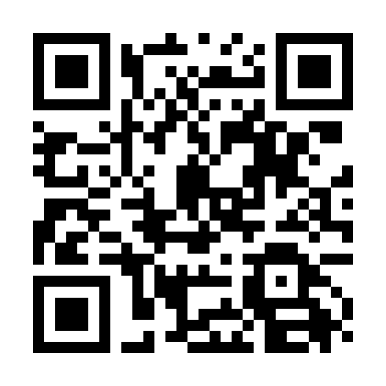
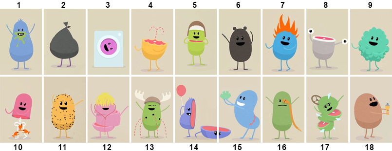
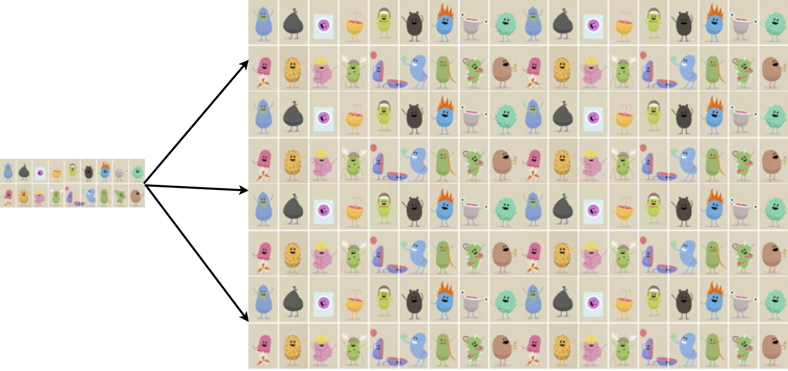
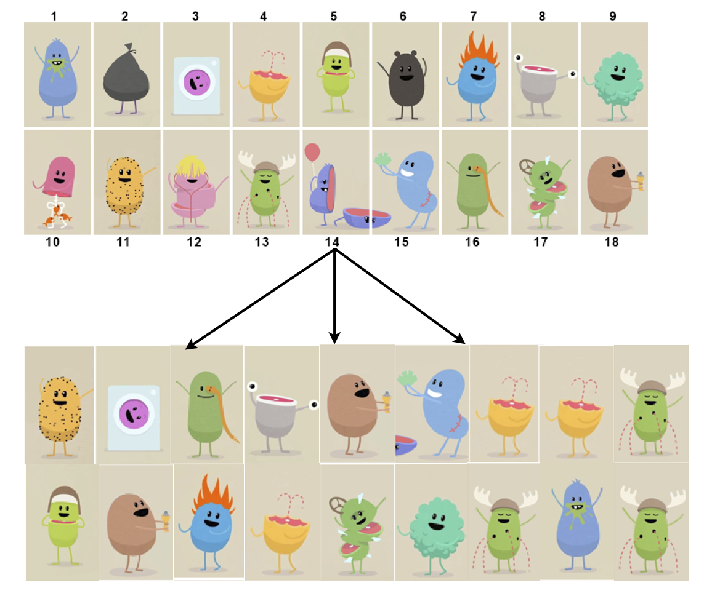
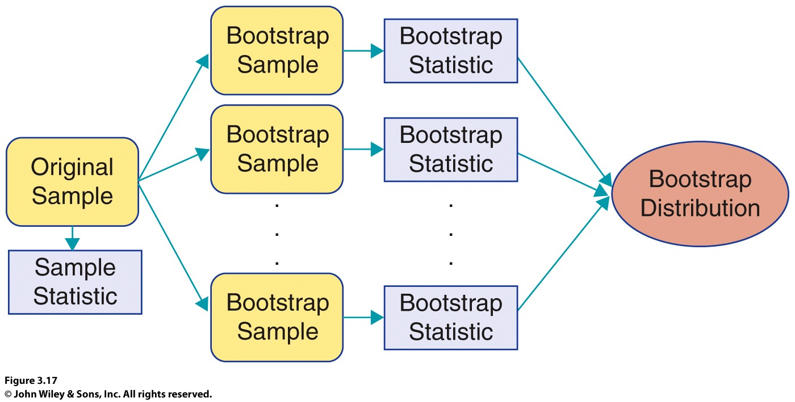
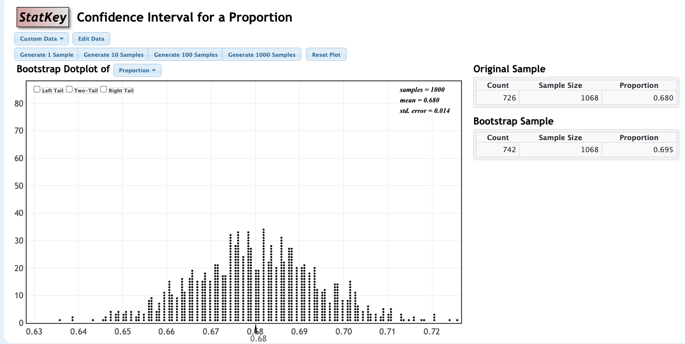
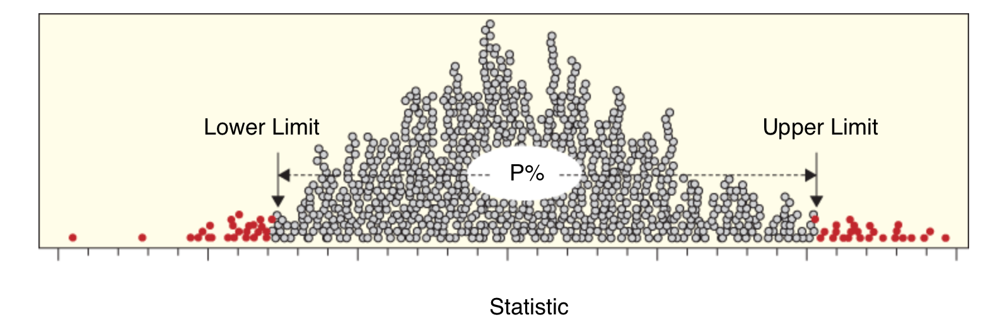

```{r, echo=F,message=FALSE}
library(mosaic)
library(Lock5Data)
```

# 3.3 Constructing Bootstrap Confidence Intervals {background-color="#FAD9C7"}

## Review from Last Time

To create a 95% confidence interval for a parameter:

1.  Take many random samples from the population.

2.  Compute the sample statistic for each sample.

3.  Compute the standard error (SE) as the standard deviation of these statistics.

4.  Compute the interval $\text{statistic}\pm 2\cdot\text{SE}$

**But there's one small problem...**

## The Problem

-   In reality, **we only have one sample!**

-   How do we know how much sample statistics vary, if we only have one sample?!?

$\Rightarrow$ Use the **bootstrap!!**

## Activity: Number of Laughs in a Day {.smaller}

How many times do you think you laugh in a day? <u>&nbsp;&nbsp;&nbsp;&nbsp;&nbsp;&nbsp;&nbsp;&nbsp;&nbsp;&nbsp;</u>

Suppose the following gives the number of laughs in a day for **six people**:

<table class="fillin">
<tr><td>16</td><td>22</td><td>9</td><td>31</td><td>6</td><td>42</td></tr>
</table>

Using this sample, what is the mean number of laughs in a day?

::: {.ws}
:::

::: notes
Let students answer the first question on their own (collect a few guesses if you like: it frames "laughs per day" as a quantity that varies from person to person).

Sample mean: (16 + 22 + 9 + 31 + 6 + 42)/6 = 126/6 = **21** laughs per day.

Set up the problem: this is our ONE sample. We want to know how much sample means would vary from sample to sample, but we can't go back to the population. Do not mention the word "bootstrap" yet; let students invent the idea on the next slide.
:::

## Activity: Make Bootstrap Samples with Tickets {.smaller}

**Use this data, and tickets, to create bootstrap samples.**

16, 22, 9, 31, 6, 42

How many tickets do you need? <u>&nbsp;&nbsp;&nbsp;&nbsp;&nbsp;&nbsp;&nbsp;&nbsp;</u>

What do you put on the tickets?

::: {.ws .ed contenteditable="true"}
:::

What do you do with the tickets to create a bootstrap sample?

::: {.ws-l .ed contenteditable="true"}
:::

What statistic do you compute from the bootstrap sample? <u>&nbsp;&nbsp;&nbsp;&nbsp;&nbsp;&nbsp;&nbsp;&nbsp;&nbsp;&nbsp;&nbsp;&nbsp;</u>

::: notes
Answers:

- **6 tickets** (one per person in the original sample, i.e., the same size as the sample).
- Put **one value** on each ticket: 16, 22, 9, 31, 6, 42 (one ticket per case).
- Mix the tickets, **draw one at random, record its value, put it back** (replace it), mix again, and repeat until you have drawn **6 values** in all. Because tickets go back, a value can show up more than once and some may not show up at all.
- Compute the **mean** of the six recorded values (the same statistic as the original sample: the mean).

Hand out tickets (or have students tear up the handout). Let pairs argue about "put it back": if they don't replace, they just get the original six values in a different order and the mean is always 21.
:::

## Activity: Your Bootstrap Samples {.smaller}

Use your tickets to find **three bootstrap samples**. Record each sample and compute its bootstrap statistic (the mean).

<table class="fillin">
<tr><th>Bootstrap sample</th><th colspan="6">Six values drawn</th><th>Bootstrap mean</th></tr>
<tr><td class="lab">1</td><td>&nbsp;</td><td>&nbsp;</td><td>&nbsp;</td><td>&nbsp;</td><td>&nbsp;</td><td>&nbsp;</td><td>&nbsp;</td></tr>
<tr><td class="lab">2</td><td>&nbsp;</td><td>&nbsp;</td><td>&nbsp;</td><td>&nbsp;</td><td>&nbsp;</td><td>&nbsp;</td><td>&nbsp;</td></tr>
<tr><td class="lab">3</td><td>&nbsp;</td><td>&nbsp;</td><td>&nbsp;</td><td>&nbsp;</td><td>&nbsp;</td><td>&nbsp;</td><td>&nbsp;</td></tr>
</table>

::: {.fragment}
**Turn and talk (30-60 sec):** Compare your bootstrap means with those around you. Are they all the same? Are they close? What does that tell you about the variability of the bootstrap statistics?
:::

::: notes
Give students about 3-4 minutes to draw. Walk around; watch for students who forget to replace tickets (all six values distinct) or who draw only 3 values.

Expected: each bootstrap mean is a number near 21 but they differ from person to person, roughly between 12 and 30. Example bootstrap sample: 9, 42, 9, 16, 31, 9 gives mean 19.3.
:::

## Enter Your Three Bootstrap Means

::: {.r-stack}
{fig-align="center" height="430"}
:::

<p style="text-align:center;">Scan the QR code to open the MS Forms page and enter your **3 bootstrap means**.<br>
<small>Or go to <b>https://forms.office.com/r/wL0yj94jBZ</b></small></p>

::: notes
Replace the QR image (figs/sec3p3_qr_laughs_form.png) if you move to a different form. The current image encodes the link printed on your handout: https://forms.office.com/r/wL0yj94jBZ.

Leave this up while students enter their means. Then export or display the responses and make a quick dotplot of all the bootstrap means (e.g., paste into R, or a StatKey custom dataset) for the next slide.
:::

## What Do the Class's Bootstrap Means Tell Us? {.smaller}

Look at the dotplot of everyone's bootstrap means.

::: {.fragment}
**Turn and talk (60 sec):**

1.  Where is this distribution centered? Why does that make sense?

2.  About how much do the bootstrap means vary?

3.  How might we use this to estimate how much a sample mean varies?
:::

::: notes
1. Centered near **21**, the mean of the original sample (the bootstrap distribution is centered at the sample statistic, not at the unknown population mean). This sets up the "Center" slide later.
2. Spread: the standard deviation of the bootstrap means. For this sample, the theoretical bootstrap SE is sqrt(936/6)/sqrt(6) = **about 5.1** laughs (population-style SD of the 6 values is 12.5; sample SD is 13.7), so most bootstrap means fall roughly between 11 and 31, and your class dotplot should be close to that. With only 6 values the dotplot will look lumpy; that's fine, it is a live illustration.
3. The standard deviation of the bootstrap means estimates the **standard error** of the sample mean, which is exactly what we need for statistic +/- 2 SE.

Transition: "What you just did by hand is called the bootstrap. A computer can do it thousands of times."
:::

## Bootstrap?


## Population

We don't observe the population so imagine the population is many copies of the **original sample**

## Original Sample



## Population



## Sampling With Replacement

-   To simulate a sampling distribution, we can just take repeated random samples from this "population" made up of infinitely many copies of the sample but...

-   In reality, we can’t make infinite copies of the sample...

-   Instead, sample repeatedly **with replacement**

    -   Each case can be selected more than once.

**Note:** This is reasonable because a good **random sample** is our buest guess at what the population looks like.

## Bootstrap Sample

-   Sample **with** replacement from the **original sample**, using the **same sample size**

{fig-align="center"}

## Quick Self-Quiz: Bootstrap Samples {.smaller}

A sample consists of the following values: **8, 4, 11, 3, 7**.

Which of the following are possible bootstrap samples from this sample? Circle all that are possible.

a)  8, 3, 7, 11

b)  4, 11, 4, 3, 3

c)  3, 4, 5, 7, 8

d)  7, 8, 8, 3, 4

For each one that is **not** possible, explain why not.

::: {.ws-l .ed contenteditable="true"}
:::

::: notes
**b and d** are possible bootstrap samples.

- a) Not possible: it has only 4 values. A bootstrap sample must be the **same size** as the original sample (5).
- b) Possible: every value came from the original sample; values can repeat (4 and 3 appear twice), and 8 and 7 happened not to be drawn.
- c) Not possible: 5 is not in the original sample. (This is just the original sample with 11 replaced by 5; bootstrap samples can only use values that are in the original sample.)
- d) Possible: 8 appears twice, 11 not at all. Repeats are allowed because we sample with replacement.
:::

## Bootstrap

-   A **bootstrap sample** is a random sample taken with replacement from the original sample, of the same size as the original sample.

-   A **bootstrap statistic** is the statistic computed on a bootstrap sample (mean, proportion, difference in means, etc.)

-   A **bootstrap distribution** is the distribution of many bootstrap statistics.

## Example 1: M&Ms {.smaller}

We wish to estimate the proportion of M&Ms that are orange, and we have one package of M&Ms containing 20 pieces.

Describe carefully how we can use this one sample to create a bootstrap statistic. Be specific.

::: {.ws-l .ed contenteditable="true"}
:::

::: {.ws-l .ed contenteditable="true"}
:::

::: notes
Answer: Treat the 20 candies as the "population." Draw one M&M at random, record its color, **put it back**, and repeat until you have **20 draws** (same size as the original sample). Compute the proportion of the 20 draws that are orange: that is one bootstrap statistic, p-hat*. (Equivalently: write each of the 20 colors on a ticket; sample 20 tickets with replacement.) Repeating many times gives a bootstrap distribution of p-hat*.

Tie back to the activity: same idea, but the statistic is a proportion instead of a mean. Common mistakes: sampling without replacement; using a sample size other than 20; recording the count instead of the proportion (fine, but the statistic of interest is the proportion).

If, say, 4 of the 20 were orange (p-hat = 0.20), the bootstrap SE would be about sqrt(0.2*0.8/20) = 0.09.
:::

# 



## Center

-   The **sampling distribution** of a statistic is centered around the corresponding population parameter but...

-   The **bootstrap distribution** is centered around the observed sample statistic

-   Luckily, we use the **bootstrap distribution** just to learn about **variability** (not the center)

## Standard Error

-   The **variability** of the bootstrap statistics is similar to the variability of the sample statistics

> Use the standard deviation of the bootstrap distribution to estimate the SE of the statistic!

## What statistics can we bootstrap?

-   Mean $(\bar x)$\
-   Proportion $(\hat p)$\
-   Difference in Means $(\bar x_1-\bar x_2)$\
-   Difference in Proportions $(\hat p_1-\hat p_2)$\
-   Correlation $(r)$
-   Regression slope $(b)$
-   Standard deviation $(s)$ ...

## Bootstrapping in a Nutshell

1.  Generate samples with replacement

2.  Calculate sample statistic

3.  Repeat...

$\Longrightarrow$ Use the bootstrap distribution to estimate the SE of the statistic

## A 95% Confidence Interval Using a Bootstrap Standard Error

> When a bootstrap distribution for a sample statistic is symmetric and bell-shaped, we estimate a 95% confidence interval using $$\text{Statistic}\pm 2\cdot \text{SE}$$ where SE denotes the standard error of the statistic estimated from the bootstrap distribution.

## Example 2: Global Warming {.smaller}

What percentage of Americans believe global warming is happening? In April 2026, the Yale Program on Climate Change Communication surveyed 1,068 U.S. adults in a nationally representative survey. 726 of them said they think global warming is happening. A bootstrap distribution for this data is shown.

:::: {.columns}
::: {.column width="60%"}
{height="300"}
:::

::: {.column width="40%"}
Use the information shown to give a 95% CI for the proportion of Americans who think global warming is happening.

::: {.ws}
:::

Interpret your interval in context.

::: {.ws-l .ed contenteditable="true"}
:::
:::
::::

::: aside
Source: Yale Program on Climate Change Communication and George Mason University, *Climate Change in the American Mind: Beliefs & Attitudes, Spring 2026* (n = 1,068; April 17-26, 2026).
:::

::: notes
**Data:** The report gives 68% of adults saying global warming is happening (16% not happening), n = 1,068. The count 726 is reconstructed as 0.68 x 1068 = 726.2, so it is a simplification: the published 68% is rounded (it could be anywhere from 67.5% to 68.5%, i.e., counts of about 721-732), and the actual survey is weighted. Students do not need this detail; mention it if someone asks "how did they get exactly 726?"

**StatKey image to add** (save as figs/sec3p3_climate2026_statkey.png): Bootstrap Confidence Intervals > CI for Single Proportion > Edit Data > enter Count = 726, Sample size n = 1068 > OK. Click Generate 1000 Samples a few times (the old screenshot used 3000). Sample proportion shows 0.680.

**Expected values:** p-hat = 726/1068 = **0.680**. Bootstrap SE about **0.014** (theory: sqrt(0.68 x 0.32/1068) = 0.0143; a simulation of 3000 bootstrap samples gave 0.0144).

95% CI: 0.680 +/- 2(0.014) = 0.680 +/- 0.028 = about **(0.652, 0.708)**, i.e., roughly (65%, 71%).

**Interpretation:** We are 95% confident that the proportion of all U.S. adults who think global warming is happening is between about 0.65 and 0.71 (65% to 71%) [based on this spring 2026 survey].

Check the bootstrap distribution first: symmetric and bell-shaped, so the SE method is OK. It is centered at the sample proportion (about 0.680), not at the unknown population value.

**Source check:** Numbers are from the Yale/GMU report page (Spring 2026: 68% yes vs. 16% no, n = 1,068, April 17-26, 2026, adults 18+ in the 50 states and DC; report states an average margin of error of +/- 3 points at 95%). The slide paraphrases the question; I could not read the exact question wording or the survey-method appendix (mode and weighting), so check Appendix II of the report PDF if you want to quote the wording. For comparison, the Fall 2025 report (n = 1,146, Nov 6-14, 2025) had 72% saying yes; the earlier 2010 Pew version of this example had 59% saying "solid evidence" (n = 2,251), a different question, so the two are not directly comparable.

**Possible extension:** The interval's width is about +/- 3 points, which matches the report's stated margin of error, a nice link to the later margin-of-error material.
:::

## StatKey: Bootstrap CI for a Mean {.smaller}

Is normal body temperature really 98.6°F? A sample of body temperatures for 50 healthy individuals was taken. We will use StatKey.

1.  Go to **StatKey** and choose **Bootstrap Confidence Intervals: CI for Single Mean, Median, Std. Dev.**

2.  Under the dataset menu, select **Body Temperatures** (n = 50).

3.  Click **Generate 1000 Samples** (at least once; more is fine).

4.  Read the **standard error** from the upper right of the dotplot: the **SD** of the bootstrap statistics.

5.  Keep this window open. We will use the same bootstrap distribution again.

::: notes
No answers on this slide. Click-by-click guide; menu wording may differ slightly in the current version of StatKey, so check against the live site before class. Students need at least 1000 bootstrap statistics (several clicks of "Generate 1000 Samples" is fine).

If students get slightly different numbers than the notes on the next slide, that is expected and a good point to make (see "Number of Bootstrap Samples" later).
:::

## Example 3: Body Temperature {.smaller}

Use StatKey to answer the questions that follow.

a)  What is the sample mean? What is the sample standard deviation?

::: {.ws}
:::

b)  Generate a bootstrap distribution, using at least 1000 simulated statistics. What is the standard error?

::: {.ws}
:::

c)  Use the standard error to find a 95% confidence interval. Show your work. Is 98.6 in the interval?

::: {.ws-l}
:::

::: notes
Expected values (Lock5 BodyTemp50 data; approximate; confirm against StatKey before class, since I could not run StatKey or access the data here):

a) Sample mean about **98.26°F**, sample standard deviation about **0.765°F** (StatKey shows these in the Original Sample box).

b) Bootstrap SE about **0.11** (roughly s/sqrt(n) = 0.765/sqrt(50) = 0.108). Students' values will vary slightly, e.g., 0.10 to 0.11.

c) 98.26 +/- 2(0.11) = 98.26 +/- 0.22, about **(98.04, 98.48)**. **98.6 is not in the interval**, so 98.6 is not a plausible value for the mean body temperature of healthy adults based on this sample.

Check that the bootstrap distribution is symmetric and bell-shaped before using the SE method.
:::

## Summary {.smaller}

-   To generate a bootstrap distribution, we:

    1.  Generate bootstrap samples by sampling with replacement from the original sample, using the same sample size.

    2.  Compute the statistic of interest, a bootstrap statistic, for each of the bootstrap samples.

    3.  Collect the statistics for many bootstrap samples to form a bootstrap distribution.

    4.  If the bootstrap distribution is symmetric and bell-shaped, a 95% CI can be estimated by $\text{Statistic}\pm 2\cdot \text{SE}$ where SE can be estimated as the standard deviation of a bootstrap distribution.

# 3.4 Bootstrap Confidence Intervals using Percentiles {background-color="#FAD9C7"}

## Outline

-   Confidence intervals based on bootstrap percentiles

-   Different levels of confidence

-   Impact of sample size and level of confidence on interval width

-   Cautions for bootstrap intervals

## Beyond 95%: The Percentile Method

> If the bootstrap distribution is **approximately symmetric**, we can construct a confidence interval by finding the **percentiles** in the bootstrap distribution so that the proportion of bootstrap statistics *between* the percentiles matches the *desired confidence level.*

## The Percentile Method

-   For a P% confidence interval, keep the middle P% of bootstrap statistics.

{fig-align="center"}

## Example 3 (continued): Percentile Method {.smaller}

*Recall: body temperatures of 50 healthy individuals. Keep the same StatKey bootstrap distribution open.*

d)  Using the same distribution, find a 95% confidence interval using the "Two-tail" option (the percentile method). Give your confidence interval here:

::: {.ws}
:::

e)  Compare the two 95% confidence intervals you found. Are they similar?

::: {.ws-l .ed contenteditable="true"}
:::

::: notes
StatKey steps: check the **Two-Tail** box under the dotplot; the default shaded middle area is 95%, and the endpoints are shown below the plot.

d) About **(98.05, 98.47)** (will differ slightly from student to student because each bootstrap distribution is random).

e) Yes. The two 95% intervals (SE method vs. percentile method) are very similar, as expected when the bootstrap distribution is symmetric and bell-shaped. Both exclude 98.6.
:::

## The Percentile Method: 99% Interval

-   For a 99% confidence interval, keep the middle 99%, leaving 0.5% in each tail.

    -   The 99% confidence interval would be $$
        (0.5\text{th percentile}, 99.5\text{th percentile})
        $$ where the percentiles refer to the bootstrap distribution.

## Level of Confidence

-   As confidence level **increases**, interval becomes **wider**
    -   Why? To catch more plausible values.\
    -   A 99% confidence interval contains the middle 99% of the bootstrap distribution while a 90% interval would contain only the middle 90%.
-   As sample size $(n)$ **increases**, interval becomes **narrower**
    -   Why? More precise estimate.

## Example 3 (continued): 99% Interval {.smaller}

*Recall: still using the same bootstrap distribution of the 50 body temperatures.*

f)  Give a 99% confidence interval:

::: {.ws}
:::

g)  Is the 99% confidence interval wider or narrower than the 95% confidence interval?  <u>&nbsp;&nbsp;&nbsp;&nbsp;&nbsp;&nbsp;&nbsp;&nbsp;&nbsp;&nbsp;&nbsp;&nbsp;</u>

h)  Clearly interpret the 99% confidence interval in context.

::: {.ws-l .ed contenteditable="true"}
:::

::: notes
StatKey: with **Two-Tail** checked, change the shaded middle proportion to **0.99** (equivalently 0.005 in each tail). Check wording against your StatKey screen.

f) About **(98.00, 98.52)** (will vary a bit by student).

g) **Wider.** To be 99% confident we must capture more of the bootstrap distribution (the middle 99% instead of the middle 95%).

h) We are 99% confident that the mean body temperature of healthy individuals is between about 98.00°F and 98.52°F. Since 98.6 is outside even the 99% interval, there is strong evidence that the mean body temperature is below 98.6°F.

Note the observational-data/sample caveat: this is based on a sample of 50 healthy individuals, and the interval is for the population mean, not for individual body temperatures.
:::

## Two Approaches to a Bootstrap Confidence Interval

1.  **Standard Error Method:** Estimate the SE of the statistic by computing the standard deviation of the bootstrap distribution, and then generate a 95% confidence interval by $$
    \text{Statistic}\pm 2\cdot\text{SE}
    $$

2.  **Percentile Method:** Generate a P% confidence interval as the range for the middle P% of bootstrap statistics.

## Two Methods

-   Either the standard error method or the percentile method will give similar 95% confidence intervals.

-   If a level of confidence other than 95% is desired, use the percentile method.

## Cautions

::: {.callout-important title="Cautions"}

-   These methods for creating a confidence interval only work if the bootstrap distribution is **smooth and symmetric**

-   **ALWAYS** look at a plot of the bootstrap distribution!

-   If the bootstrap distribution is **highly skewed** or looks **“spiky” with gaps**, you will need to go beyond intro stat to create a confidence interval.

    -   Example: Don't use the bootstrap for the median or quartiles!

:::

## Number of Bootstrap Samples

-   When using bootstrapping, you may get a slightly different confidence interval each time. This is fine!

-   The more bootstrap samples you use, the more precise your answer will be.

-   For the purposes of this class, 1000 bootstrap samples is fine.

    -   In real life applications, you would likely take 10,000 or even 100,000 bootstrap samples.

## Summary

-   95% confidence intervals can be created using the **standard error** or the **percentiles** of a bootstrap distribution.

-   For any other desired level of confidence, the **percentile** method may be used.

-   A confidence interval from bootstrap percentiles can be created for any parameter, as long as the bootstrap distribution is approximately **smooth and symmetric**.
