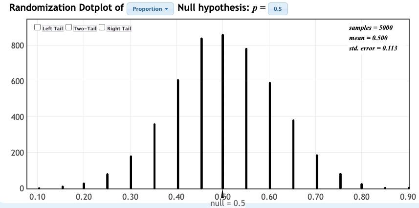
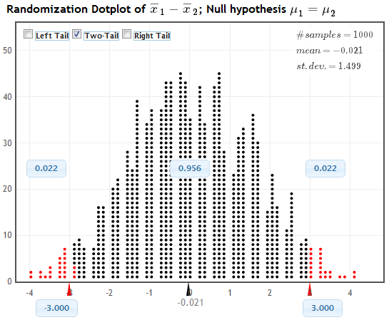

```{r, echo=F,message=FALSE}
library(mosaic)
library(Lock5Data)
```

## Warm-Up: Spinning Pennies {.smaller}

1.  **Predict** the probability of heads when spinning a penny.
2.  **Spin** your penny 20 times (do it well!).
3.  **Record** the number of heads.
4.  Put a **tick mark on the board** under your value.

<table class="fillin">
<tr><th>My prediction of P(heads)</th><th>My number of heads (out of 20)</th><th>My proportion of heads</th></tr>
<tr><td></td><td></td><td></td></tr>
</table>

::: notes
Spin on a hard, flat surface: stand the penny on its edge, twist it with two fingers, and let it fall flat on its own (no bumping the table, no flipping). Record heads each time.

Most students predict 0.5. Real pennies often come out noticeably below that (spinning is not like flipping; the two faces are not balanced, and Gelman and Nolan have written about spun pennies landing heads well under half the time), so students are usually surprised. Build the tick-mark dotplot on the board as students report. Do not explain the result yet; leave it as a puzzle.
:::

## Our Class Data {.smaller}

The tick marks on the board show the number of heads in 20 spins for each student.

(a) Sketch the distribution of the class results. Label the axis.

::: {.ws-l}
:::

(b) Describe the center and spread. Is 10 heads typical for our class?

::: {.ws .ed contenteditable="true"}
:::

::: notes
(a) Have students copy the board. The class distribution will usually be centered below 10 and may be a bit spread out (each student has a different penny and spinning technique).

(b) Typical talking point: most of the class has fewer than 10 heads, so the center is clearly below 10. Is that just luck of the draw, or is spinning really biased toward tails?
:::

## If Spinning Were Fair

**Turn and talk (60 sec):** If spinning a penny were just like flipping a fair coin, how many heads out of 20 would be typical? How many heads would surprise you?

::: notes
For a fair coin, we expect about 10 heads, and anything from about 6 to 14 is not surprising; 3 or 17 would be shocking. That sets up the main question: how unusual is our sample statistic *if* the null hypothesis (p = 0.5) were true? Move to the Key Questions slide.

Later (Randomization Distribution slide): return to this penny data with StatKey (Test for a Single Proportion, null proportion 0.5, n = 20, generate 1000 samples) and compare that fair-coin distribution to the class tick marks.
:::


# Key Questions

:question: How unusual is it to see a sample statistic as extreme as that observed, if $H_0$ were true?

-   If it is very unusual, we have statistically significant evidence against the null hypothesis

But *how* do we **measure** how unusual a sample statistic is, if $H_0$ were true?

## Quantifying Evidence Against the Null Hypothesis

To see if a statistic provides evidence against $H_0$, we need to explore...

::: incremental
-   what kind of sample statistics we would observe\
-   just by *random chance*\
-   **if** $H_0$ were true.\
:::

::: notes
Back to the pennies: spinning 20 times and counting heads. A randomization distribution shows what counts we would get from a *fair* penny, just by chance.
:::

## Randomization Distribution {.smaller}

-   A **randomization distribution** is a collection of statistics from samples simulated assuming the null hypothesis is true

-   The randomization distribution shows what values of statistics would be observed, just by random chance, *if the null hypothesis were true*

{fig-align="center" height="230"}

::: {.fragment}
**Turn and talk (30 sec):** Where is this distribution centered? Why?
:::

::: notes
Centered at the null value (0 for a difference in means, 0.5 for the penny proportion), because the simulation assumes H0 is true. Connects back to the penny warm-up: the "fair spin" world. The figure is StatKey's Test for a Single Proportion (null 0.5, n = 20, 1000 samples; mean 0.495, SE 0.113). Compare it to the class tick marks on the board (convert counts to proportions: 6 heads = 0.30). Better still, regenerate it live in StatKey.
:::

## Key Question

:question: How unusual is it to see a sample statistic as extreme as that observed, if $H_0$ is true?

:::{.incremental}
-   A **randomization distribution** tells us what values of statistics we would see just by random chance, *if the null hypothesis were true*

-   Use the distribution to assess how extreme the observed statistic is!
:::

## p-value

The $p$-value is the chance of obtaining a sample statistic as extreme (or more extreme) than the observed sample statistic, *if the null hypothesis were true*

::: fragment
**Calculate** the $p$-value as the proportion of statistics in a randomization distribution that are as extreme (or more extreme) than the observed sample statistic
:::

::: fragment
**Turn and talk (30 sec):** In your own words, what does a $p$-value of 0.03 tell us?
:::

::: notes
Listen for the common error: "there is a 3% chance H0 is true." Correct: if H0 were true, only 3% of random samples would give a statistic this extreme or more.
:::

## Calculating a p-value

1.  What kinds of statistics would we get, just by random chance, if the null hypothesis were true?

    Answer: the randomization distribution

::: fragment
2.  What proportion of these statistics are as extreme as our original sample statistic?

    Answer: the $p$-value
:::

## Alternative Hypothesis

-   A one-sided alternative contains either $>$ or $<$

-   A two-sided alternative contains $\neq$

-   The $p$-value is the proportion **in the tail in the direction specified by** $H_a$

-   For a two-sided alternative, the $p$-value is **twice the proportion in the smallest tail**

## Estimating a P-value from a Randomization Distribution

-   **One-tailed alternative**: Find the proportion of randomization samples that **equal or exceed** the original statistic in the direction (tail) indicated by the alternative hypothesis.

::: fragment
-   **Two-tailed alternative**: Find the proportion of randomization samples in the smaller tail **at or beyond the original** statistic and then **double the proportion** to account for the other tail.
:::

## Guidelines for Thinking About P-values

When wording conclusions from a test of significance, you can consider:

::: incremental
-   $.05\le p \le .10 \implies$ *slight* evidence

-   $.01\le p \le .05 \implies$ *some* or *moderate* evidence

-   $p \le .01 \implies$ *strong* or *convincing* evidence
:::

## Example: Sleep or Caffeine {.smaller}

Students memorized words, then were randomly assigned to take a 90-minute nap or a caffeine pill and were tested on recall. Do the data show a *difference* in mean words recalled?

$H_0: \mu_s = \mu_c$ vs $H_a: \mu_s \neq \mu_c$, with sample statistic $\bar{x}_s - \bar{x}_c = 3.0$

{fig-align="center" height="270"}

(a) Is this a one-tailed or two-tailed test? Where is the randomization distribution centered?

::: {.ws}
:::

::: notes
(a) Two-tailed (Ha has not-equal); centered at 0 (the mean shown is -0.021), because the null says no difference.

Study design based on Mednick et al. (2008), Behavioural Brain Research. The 3.0 statistic and the randomization dotplot are from the class handout (StatKey, 1000 samples), so your own simulation will differ slightly.
:::

## Sleep or Caffeine, continued {.smaller}

Recall: $H_a: \mu_s \neq \mu_c$ and $\bar{x}_s - \bar{x}_c = 3.0$

{fig-align="center" height="200"}

(b) Use the randomization distribution to state the $p$-value.

::: {.ws}
:::

(c) What does the $p$-value tell us about the evidence against $H_0$? Answer in context.

::: {.ws-l .ed contenteditable="true"}
:::

::: notes
(b) The statistic 3.0 and its mirror image -3.0 are both shaded. Each tail has proportion 0.022, so the two-sided p-value is 2(0.022) = 0.044 (the 0.956 in the middle is 1 minus that).

(c) p = 0.044 falls in the .01 to .05 range: some (moderate) evidence that mean recall differs between nap and caffeine. Because the people were randomly assigned, a difference can reasonably be attributed to nap vs caffeine.
:::

## Activity: Beer and Mosquitoes {.smaller}

43 men were randomly assigned to drink a liter of beer (25 men) or water (18 men). The number of mosquitoes approaching each man was recorded. Is the mean number of mosquitoes approaching a beer drinker *larger* than for a water drinker?

(a) Is this an experiment or an observational study? What are the cases? What are the variables?

::: {.ws-l}
:::

(b) State the null and alternative hypotheses. Define any parameters used.

::: {.ws-l .ed contenteditable="true"}
:::

::: notes
(a) Experiment (men were randomly assigned to beer or water). Cases: the 43 men. Variables: drink (beer or water; categorical, explanatory) and number of mosquitoes approaching (quantitative, response).

(b) H0: mu_B = mu_W vs Ha: mu_B > mu_W, where mu_B and mu_W are the mean numbers of mosquitoes approaching men who drink beer / water (all men like these). One-sided because the question asks whether beer drinkers attract *more*.
:::

## Beer and Mosquitoes: StatKey {.smaller}

(c) In StatKey (lock5stat.com/statkey), choose **Test for Difference in Means**, select the **Beer and Mosquitoes** dataset, and click **Generate 1000 Samples**. Classify each possible difference in means as (i) very likely, (ii) unlikely but possible, or (iii) very unlikely to ever occur just by chance.

<table class="fillin">
<tr><th class="lab">Difference in means</th><th>\(-7\)</th><th>\(-3\)</th><th>\(-0.5\)</th><th>\(1\)</th><th>\(5\)</th></tr>
<tr><td class="lab">(i), (ii), or (iii)?</td><td></td><td></td><td></td><td></td><td></td></tr>
</table>

::: notes
Randomization distribution is centered near 0 with a standard error of roughly 1.3 (your simulation will vary slightly), roughly bell-shaped.

-7: (iii) very unlikely (more than 5 SEs out; nothing plotted).
-3: (ii) relatively unlikely but occasionally occurs (a few percent of dots at or beyond it in the tail).
-0.5: (i) very likely.
1: (i) very likely.
5: (iii) very unlikely (about 4 SEs out; typically no dots at or beyond it in 1000 samples).

Tip for StatKey: the group assignment does not matter for the shape; the difference is Beer minus Water. In StatKey, check the label above the plot to see which group is first.
:::

## Beer and Mosquitoes: p-value {.smaller}

Recall: $H_0: \mu_B = \mu_W$ vs $H_a: \mu_B > \mu_W$

(d) Find the difference in means observed in the study (shown for the **Original Sample** in StatKey). Give the notation and the value of the sample statistic.

::: {.ws}
:::

(e) Where does the sample statistic lie in the randomization distribution? Is it likely or unlikely to occur just by random chance?

::: {.ws-l .ed contenteditable="true"}
:::

(f) In StatKey, check the **Right Tail** box and use the sample statistic to find the $p$-value. Is it large or small?

::: {.ws}
:::

::: notes
(d) $\bar{x}_B - \bar{x}_W = 23.6 - 19.22 = 4.38$ (beer group mean 23.6, water group mean 19.22).

(e) 4.38 is far out in the right tail, about 3 to 4 SEs above 0 -- beyond (or at the very edge of) nearly all the randomization dots. It is very unlikely to occur just by random chance if beer had no effect.

(f) Right-tail test (Ha has ">"), so no doubling. The p-value is tiny: about 0.000 to 0.002 in 1000 simulated samples (zero or one or two dots). Small, so strong evidence against H0 (p <= .01): evidence that beer drinkers attract more mosquitoes on average. Random assignment supports a cause-and-effect conclusion for these men.

Caveat if asked: results apply to the kind of men in the study (adult male volunteers), not everyone.
:::

## Quick Self-Quiz {.smaller}

To test $H_0: \mu = 50$ vs $H_a: \mu < 50$ using sample data with $\bar{x} = 43.7$:

(a) Where will the randomization distribution be centered? Why?

::: {.ws .ed contenteditable="true"}
:::

(b) Is this a left-tail test, a right-tail test, or a two-tail test?

::: {.ws}
:::

(c) How can we find the $p$-value once we have the randomization distribution?

::: {.ws-l .ed contenteditable="true"}
:::

::: notes
(a) At 50, the null value, because the randomization samples are generated assuming H0 is true.

(b) Left-tail: Ha has "<", so the p-value is the proportion in the lower tail.

(c) Find the proportion of randomization statistics that are 43.7 or smaller. No doubling, since the test is one-sided.
:::

## Summary {.smaller}

::: incremental
-   The randomization distribution shows what types of statistics would be observed, just by random chance, *if the null hypothesis were true*.

-   A $p$-value is the chance of getting a statistic as extreme as that observed, *if* $H_0$ were true.

-   A $p$-value can be calculated as the proportion of statistics in the randomization distribution *as extreme or more extreme than the observed sample statistic*.

-   The smaller the *p*-value, the greater the evidence against $H_0.$
:::
