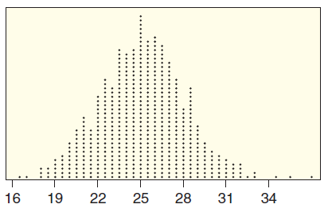
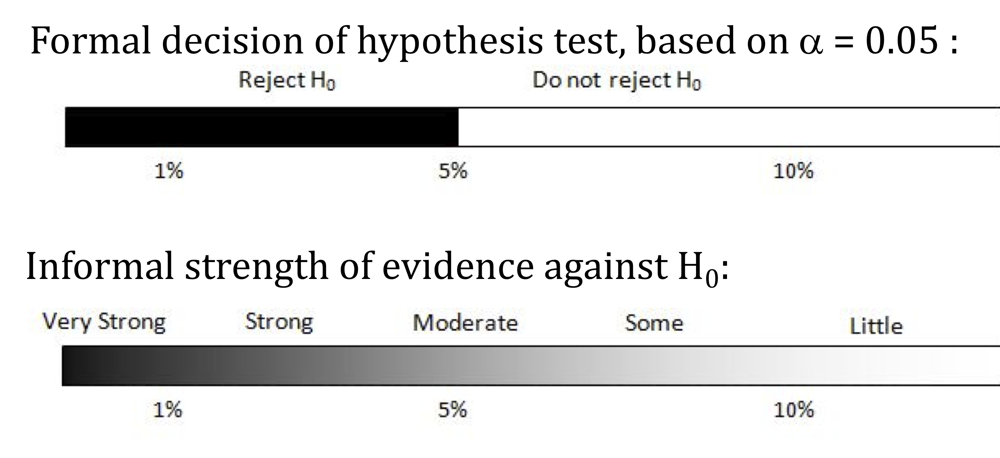

```{r, echo=F,message=FALSE}
library(mosaic)
library(Lock5Data)
```

## p-value and $H_0$

-   If the p-value is small, then a statistic as extreme as that observed would be unlikely if the null hypothesis were true, providing significant evidence against $H_0$.

. . .

-   The *smaller* the p-value, the *stronger* the evidence against the null hypothesis and in favor of the alternative.

## Quick Self-Quiz: Which p-value shows more evidence? {.smaller}

In each case, which p-value provides the **strongest evidence against $H_0$** and for $H_a$?

a\) p-value = 0.95 or p-value = 0.02

::: {.ws}
:::

b\) p-value = 0.008 or p-value = 0.02

::: {.ws}
:::

::: notes
(a) 0.02. (b) 0.008. Smaller p-value = stronger evidence against H0. Common slip: students think 0.95 is "high so more evidence"; remind them the p-value is the chance of a result this extreme *if H0 were true*, so a tiny value means the data would be surprising under H0.
:::

## Formal Decisions {.smaller}

#### If the $p$-value is small:

-   **Reject** $H_0$
-   the sample would be **extreme** if $H_0$ were true
-   the results are **statistically significant**
-   we have evidence for $H_a$

#### If the $p$-value is **not** small:

-   **Do not reject** $H_0$
-   the sample would not be too extreme if $H_0$ were true
-   the results are **not statistically significant**
-   the test is **inconclusive**; either $H_0$ or $H_a$ may be true

*But how small is small?*

## Class Experiment: Random Assignment {.smaller}

* First, split class members into a **Treatment** group and a **Control** group using a randomized comparative design.  

* Note which group you have been assigned to.


## Significance Level

The **significance level** $\alpha$ is the threshold *below* which the $p$-value is deemed small enough to reject the null hypothesis.

-   $p$-value $<\alpha$ $\Longrightarrow$ Reject $H_0$

-   $p$-value $\ge \alpha$ $\Longrightarrow$ Do not reject $H_0$

The most common value of $\alpha$ is .05

-   Values of .10 and .01 are also common.

## Significance Level

-   $p$-value $<\alpha$ $\Longrightarrow$ Results are **statistically significant**
    -   Reject $H_0$ in favor of $H_a$

. . .

-   $p$-value $\ge\alpha$ $\Longrightarrow$ Results are **not statistically significant**
    -   Test is inconclusive

## Self-Quiz: Determining Significance {.smaller}

For each test, write **Yes** or **No**: is the result significant at that level?

<table class="fillin sm">
<tr><th></th><th>10% level</th><th>5% level</th><th>1% level</th></tr>
<tr><td class="lab">A: p = 0.008</td><td></td><td></td><td></td></tr>
<tr><td class="lab">B: p = 0.03</td><td></td><td></td><td></td></tr>
<tr><td class="lab">C: p = 0.094</td><td></td><td></td><td></td></tr>
<tr><td class="lab">D: p = 0.23</td><td></td><td></td><td></td></tr>
</table>

**Turn and talk (30 sec):** Which test gives the strongest evidence against $H_0$? Does the answer depend on which $\alpha$ we choose?

::: notes
Answers (significant if p < alpha):

- Test A (0.008): Yes, Yes, Yes
- Test B (0.03): Yes, Yes, No
- Test C (0.094): Yes, No, No
- Test D (0.23): No, No, No

Significant at 10%: A, B, C. At 5%: A, B. At 1%: A only.

Turn and talk: Test A is strongest at every level; the evidence (the p-value) doesn't change, only the cutoff we use for the yes/no decision. Stress that alpha is chosen *before* looking at the data.
:::

## Example: Online Shopping and Spending Habits {.smaller}

An online retailer wants to know whether personalized product recommendations change customer behavior. For each p-value, write the **formal decision** and a **conclusion in context**. Use a 5% significance level.

1.  In the test to see if the mean amount spent per visit is **higher** after personalized recommendations, the p-value is 0.013.

::: {.ws .ed contenteditable="true"}
:::

2.  In the test to see if the amount of time spent browsing **changes**, the p-value is 0.980.

::: {.ws .ed contenteditable="true"}
:::

3.  In the test to see if the mean number of abandoned carts **changes**, the p-value is 0.035.

::: {.ws .ed contenteditable="true"}
:::

::: notes
1. 0.013 < 0.05: Reject H0. The results are statistically significant: we have evidence that the mean amount spent per visit is higher after personalized recommendations.
2. 0.980 >= 0.05: Do not reject H0. Not significant; the test is inconclusive. We do not have evidence that browsing time changed. (Do NOT say "browsing time stays the same": that is accepting H0. A p-value this large just means the sample is entirely consistent with H0.)
3. 0.035 < 0.05: Reject H0. Significant: evidence that the mean number of abandoned carts changes. Note it would NOT be significant at the 1% level (0.035 > 0.01). Also note the direction (increase or decrease?) is not given by the p-value alone; look at the sample statistic.

Tip: ask students to include the "evidence for Ha" language in context for 1 and 3 and "not enough evidence" language for 2.

Dropped from the original Word doc to streamline: the 0.007 part (b) and part (e) (significant at 1%), since the Self-Quiz above covers the 1% idea.
:::

## Components of a Hypothesis Test

#### A formal hypothesis test includes the following components:

::: incremental
1.  State the null and alternative hypotheses (defining parameters when necessary).

2.  Determine the value of the observed sample statistic.

3.  Find the $p$-value.

4.  Make a generic decision about $H_0:$ Reject $H_0$ or do not reject $H_0$.

5.  Write a sentence explaining the conclusion of the test in context, indicating whether or not we have convincing evidence for $H_a$ and referring back to the question of interest.
:::

## Example: Sugar in Bottled Iced Tea {.smaller}

The nutrition label on a brand of iced tea says that the average amount of sugar per bottle is 25 grams. A chemical analysis of a sample of 30 bottles finds a mean of 33.8 grams of sugar per bottle. Does this provide significant evidence that the true average is **greater than 25**?

1.  Define the parameter of interest.

::: {.ws .ed contenteditable="true"}
:::

2.  State the null and alternative hypotheses.

::: {.ws}
:::

3.  Give the notation and value of the sample statistic.

::: {.ws}
:::

::: notes
1. Let mu = the true mean amount of sugar (in grams) per bottle of this brand of iced tea.
2. H0: mu = 25 vs Ha: mu > 25.
3. x-bar = 33.8 grams (n = 30).

Next slide uses the randomization distribution to find the p-value.
:::

## Example: Sugar in Bottled Iced Tea (continued) {.smaller}

*Recall:* the sample of 30 bottles had a mean of 33.8 g, and we are testing whether the true mean sugar is more than 25 g. The randomization distribution below shows 1000 randomization statistics (assuming $H_0$ is true).

:::: {.columns}
::: {.column width="55%"}
4.  Use the randomization distribution to estimate the $p$-value.

::: {.ws}
:::

5.  Give a formal conclusion at the 5% level.

::: {.ws}
:::

6.  Give a conclusion in context.

::: {.ws-l .ed contenteditable="true"}
:::
:::

::: {.column width="45%"}
{height="190px"}
:::
::::

::: notes
4. Count the dots at or beyond 33.8 (right tail, since Ha is ">"): only about 3 of the 1000 dots, so p-value is approximately 0.003 (accept roughly 0.001 to 0.005). Note the observed 33.8 is well out in the tail of a distribution centered at 25.
5. p-value (about 0.003) < 0.05: Reject H0. Statistically significant.
6. We have strong evidence that the true mean amount of sugar per bottle of this iced tea is greater than the 25 grams stated on the label.

Remind them the center of the randomization distribution is the null value (25). Dot count was read by eye from the figure; the figure is from the original examples doc (Lock5-style dotplot).
:::

## Statistical Conclusions



## Never Accept the Null

-   "Do not reject $H_0$" is not the same as "accept $H_0$"!

-   Lack of evidence against $H_0$ is **not** the same as evidence for $H_0$!

::: {.fragment}
**Turn and talk (30 sec):** A jury returns a verdict of "not guilty." Does that prove the defendant is innocent? How is this like "do not reject $H_0$"?
:::

::: notes
Not guilty means the evidence was not strong enough to convict (reject "innocent"), not that innocence was proven. Same logic: failing to reject H0 means we lack convincing evidence against it; it is not proof that H0 is true. Link back to the online shopping browsing-time part: p = 0.980 does not show browsing time is unchanged.
:::

## Quick Self-Quiz: Making Conclusions {.smaller}

In a hypothesis test of $H_0: \mu = 18$ vs $H_a: \mu > 18$, we obtain a p-value of 0.016. Using $\alpha = 0.05$:

1.  We conclude:

    a)  Reject $H_0$
    b)  Do not reject $H_0$
    c)  Reject $H_a$
    d)  Do not reject $H_a$

2.  Which statement is correct?

    a)  There is evidence that $\mu = 18$
    b)  There is evidence that $\mu > 18$
    c)  There is no evidence of anything

::: {.ws}
:::

::: notes
1. (a) Reject H0. 0.016 < 0.05. We never "reject" or "accept" Ha in this language; tests are about H0.
2. (b) There is evidence that mu > 18. (a) would be accepting H0 (and the data went against it); (c) is wrong since p is small: we do have evidence.
:::
## Summary

::: incremental
1.  The **smaller** the p-value, the **stronger** the evidence against $H_0$. If $p$-value $< \alpha$ (usually .05), we **reject** $H_0$ and the results are **statistically significant**.

2.  A formal test: state hypotheses, find the sample statistic and $p$-value, make a decision about $H_0$, and conclude **in context** about $H_a$.

3.  **Never accept the null:** "do not reject $H_0$" means the test is inconclusive, not that $H_0$ is true.
:::
